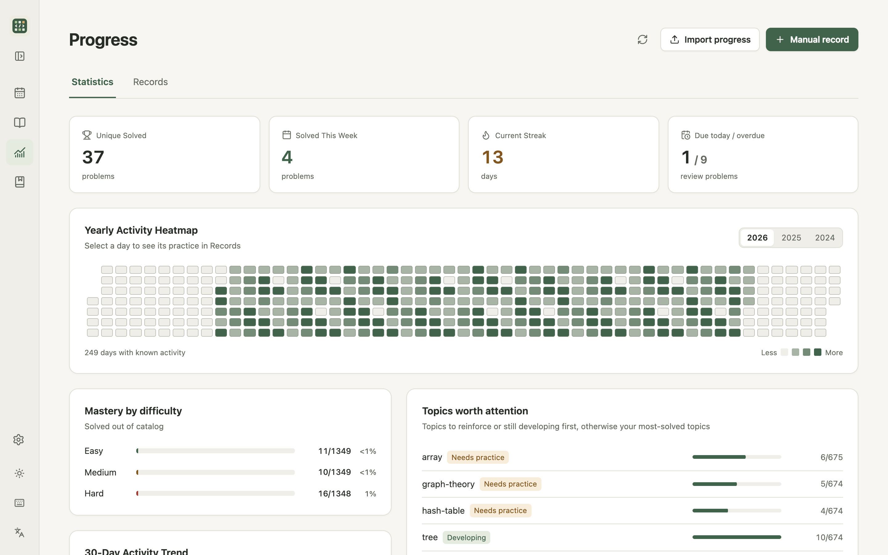
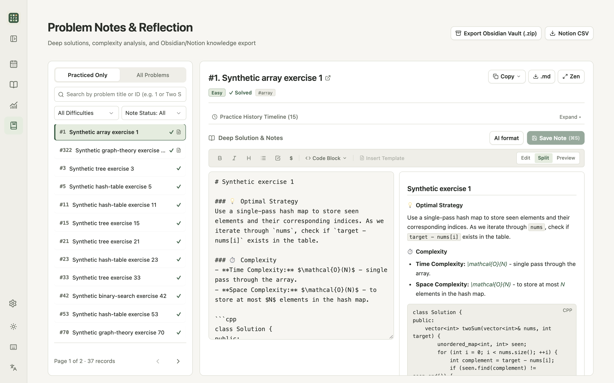
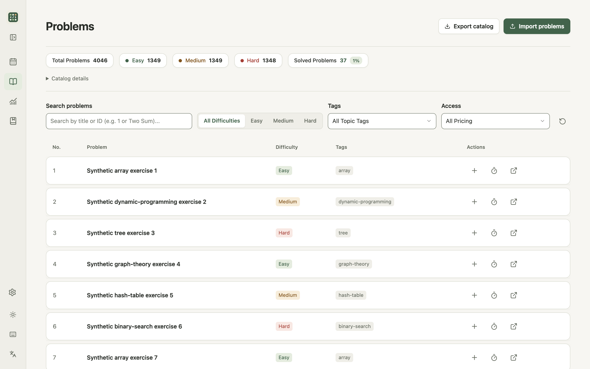
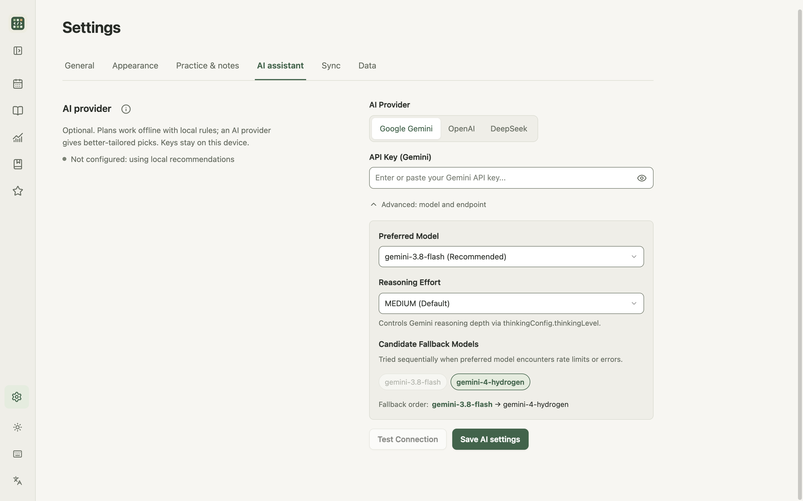
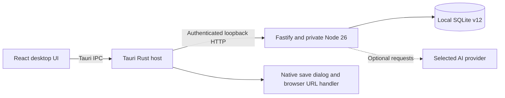

# LeetCode Tracker

<p align="center">
  
</p>

<p align="center">
  <a href="https://github.com/Yide-Milo-Li/LeetCode-Tracker/releases/latest"></a>
  <a href="docs/desktop.md"></a>
  <a href="https://github.com/Yide-Milo-Li/LeetCode-Tracker/actions/workflows/ci.yml"></a>
  <a href="docs/architecture.md"></a>
  <a href="LICENSE"></a>
</p>

A local-first desktop workbench for algorithm practice: bring your own JSONL catalog, plan a weekly routine, record practice, review progress, and keep problem notes together. The interface supports English and Simplified Chinese, desktop windows at 1024px and above, ten theme palettes with matching native app icons, and keyboard navigation.

LeetCode Tracker packages the React interface, Fastify API, SQLite engine (schema v12), and a private Node.js 26.13.0 runtime into native Tauri desktop apps for **Windows 11 x64** and **Apple Silicon macOS 14+** (`aarch64-apple-darwin`) with aligned behavior and a single-file cross-device migration bundle. **End users do not need to install Node.js, npm, Git, or Rust.**

Version 1.5.1 brings the catalog, favorites and goal lists into one Problems workspace. Use App updates on official desktop builds from 1.4.0 onward. Upgrading from 1.3.1 or earlier requires one manual install. [1.5.1 release notes](docs/releases/1.5.1.md)

## Download and start

Download the installer for your OS from the [latest release](https://github.com/Yide-Milo-Li/LeetCode-Tracker/releases/latest) and use the accompanying `SHA256SUMS.txt` to verify the download.

| Platform | Download | How to install & open |
| --- | --- | --- |
| **Windows 11 x64** | `LeetCode-Tracker_1.5.1_x64-setup.exe` | 1. Run the per-user installer (no administrator rights needed).<br>2. If Windows SmartScreen warns that the installer is unsigned, click **More info → Run anyway**.<br>3. Launch **LeetCode Tracker** from the Start Menu or Desktop shortcut. |
| **macOS 14+ (Apple Silicon)** | `LeetCode-Tracker_1.5.1_aarch64.dmg` | 1. Open the `.dmg` and drag **LeetCode Tracker.app** into **Applications**.<br>2. Because the bundle is ad-hoc signed and unnotarized, if Gatekeeper warns on first open, go to **System Settings → Privacy & Security → Open Anyway** (or right-click **LeetCode Tracker.app → Open**). If needed, verify checksum and run `xattr -cr "/Applications/LeetCode Tracker.app"`.<br>3. Closing the red window button hides the window while keeping the sidecar ready in the Dock; click the Dock icon to reopen or press `Cmd+Q` to quit cleanly. |

> [!TIP]
> **Running from a source checkout instead?** Run `npm run desktop` (works on both Windows and macOS), `start.bat` on Windows, or `npm run desktop:mac` / `./scripts/start-desktop.sh` on macOS (pass `--port 3001` or `PORT=3001` to customize the port). Source mode requires **Node.js >=26.13.0 <27**.

### Quick start in 4 steps

1. **First-run setup guide (`Today`)**: A guided three-step wizard opens on first launch:
   - **Timezone**: Pick your local timezone (with a one-click device suggestion and quick language / light-dark switches).
   - **Problems**: Import your own JSON Lines (`.jsonl`) catalog (upload a file or paste text).
   - **Study rhythm**: Pick the recommended weekday preset (`Weekdays · 3 a day`, 1 Easy + 2 Medium with 1 review) or open **Study schedule** to customize counts, difficulty mix, topic tags, and review mode. Any step can be skipped and updated later.
2. **Daily practice & timer (`Today` & `Problems`)**: Click a problem title to open it in your system browser, use the built-in stopwatch to time your attempt, and click the completion circle to log completion (with optional duration, outcome feedback `Independent` / `Assisted` / `Unsolved`, and short notes). Use **Add one**, **Adjust today**, or **Replace** anytime.
   - **Goal lists**: Open **Problems → Goal lists** to browse all lists, check their progress, or edit their contents. **Use on Today** selects the list for daily practice. Today shows daily plan progress, the selected goal’s completion in saved order, and a seven-day solve chart above the two task lists. Select a day to see its practice records. Use the list selector to switch goals. In **Today → New list**, search your catalog or paste problem IDs in practice order. In **Problems**, check rows across pages or filters and choose **Create goal list**. The draft starts in problem-number order and can be rearranged before saving. Scroll the list and check off problems as you go. **Edit** lets you reorder, replace, remove, or reopen an entry. Checking a goal-only problem on Today saves practice and offers optional details. When the goal entry is shared with today’s strategy, both entries use the same completion evidence, including an imported Accepted submission. Correcting or revoking that evidence reopens the linked entries when no other qualifying evidence remains. Older unlinked checkmarks stay local to their list.
   - In **Today**, click the star beside a strategy task or goal-list problem. Choose any folders and click **Save favorite**, or leave them unchecked to save only to **All favorites**. Click a filled star to change folders or remove the favorite.
   - In **Problems**, the star saves a problem in **All favorites** and any folders you select. To save several at once, check rows in **Problems** and choose **Favorite**. This adds them to the selected folders and keeps their existing memberships. Open **Problems → Favorites** to browse your saved problems and manage folders. In **Favorites**, check problems across folders or pages, then choose **Create goal list** or **Unfavorite**. Confirming removal clears the selected problems from every favorite folder.
   - Use the flag beside a problem in **Problems**, **Favorites** or **Today** to choose its goal lists or create one. A filled flag means the problem belongs to at least one list. Adding it to another list places it at the end.
   - To add several problems to existing goal lists, check rows across pages in **Problems** or **Favorites**, choose **Add to goal lists**, and select one or more lists. Each list keeps its current order and checkmarks. New problems are appended in problem ID order.
3. **Review progress & Topic Insights (`Progress`)**: View outcome KPIs, the 365-day activity heatmap, difficulty mastery, topics worth attention, and the searchable, recency-ordered **Topic Insights** table (expand any topic row for 30-day evidence).
4. **Write notes, export, or switch computers (`Notes` & `Settings`)**: Edit Markdown notes with Split/Edit/Preview modes, local format-on-save (with undo), optional AI formatting, and Notion card copying or Markdown, ZIP, and CSV export. Moving between Windows and macOS? Export one **Snapshot Bundle v5** under **Settings → Data → Export migration file** and import it on the other computer (**Settings → Data → Import migration file**).

The Windows installer is **unsigned** and uses the Evergreen WebView2 runtime (downloading its bootstrapper if missing, which requires internet access). Windows 11 x64 is the primary Windows target; clean-machine installation, Windows 10 compatibility, Apple Developer ID notarization, and non-developer Mac Gatekeeper UX remain outside automated checks. See [installation, data paths, and troubleshooting](docs/desktop.md) and [1.5.1 release notes](docs/releases/1.5.1.md).

### Bring your own catalog

No proprietary problem dataset or crawler is shipped. Supply metadata you have permission to use, one JSON object per line:

```jsonl
{"id":"1","title":"Two Sum","difficulty":"Easy","tags":["Array","Hash Table"]}
{"id":"15","title":"3Sum","difficulty":"Medium","tags":["Array","Two Pointers"]}
```

These are format examples, not a bundled curriculum. An AI-generated catalog can contain incorrect IDs, titles, tags, or links; review it before importing. See the [JSONL specification](docs/data-format.md) for accepted fields and normalization rules.

## Practice, understand, and retain

### Today's practice


The screenshot shows Today with a generated plan and an active goal list. On a rest day or after the final problem is removed from the plan, the seven-day activity appears in its own card.

The unified Today panel combines plan completion, Add one / Adjust today actions, a built-in practice timer linked to practice records, clickable problem titles, dual-path Note navigation (go to workspace or quick-view slide drawer), and seven-day activity. Define reusable weekly strategies with a review cap (unused review slots become new problems), a new-problem difficulty mix, and topic preferences; review spacing is one learner-wide setting. Add one runs locally without model calls; remove completed items with explicit confirmation and inspect plan versions. Recommendations explain their source. Local code owns candidate membership, uniqueness, quotas, and persistence; optional Gemini, OpenAI, or DeepSeek assistance remains advisory. Routine explanations and encouragement are local; optional semantic selection is bounded and used only for an effective choice. Outcome-based review spacing and duration-shadow calibration (Settings › Practice), per-strategy time budgets and explicit optional feedback preserve hard filters. See [local recommendations](docs/local-recommendations.md) for development-candidate policies and validation limits.

### Progress and topic insights



Progress opens Statistics first, with Records one tab away. Record completion, duration, outcome feedback, and notes; correct or revoke individual records without replacing unrelated history. Explore the yearly activity heatmap, recent trends, and topic insights. Imported progress snapshots are distinguished from individual practice records, and unknown history stays unknown.

### Notes and knowledge export



Browse a filterable problem list alongside a Markdown editor and CommonMark/GFM preview. Format on save is local, optional, and preserves code and note content. An optional AI format action proposes a layout for the whole note or a selected range; review the result before applying it to the draft. Switch between Edit, Split, and Preview, use formatting tools, one-click Notion card copying, or enter a focused Notes view. A save/discard/cancel prompt protects unsaved edits when switching problems. Keep solution notes beside each problem and its practice timeline. Export Markdown, an Obsidian ZIP, Notion CSV tables, or a portable snapshot bundle. The desktop app uses a native save dialog and atomically completes the selected file. Bundle exports omit provider keys, and bundle imports ignore incoming keys while preserving local credentials.

### Appearance and keyboard access

Ten palettes, English/Chinese text, and light/dark/system appearance support desktop work, and selecting a palette dynamically tints the window/Dock icon to match. The eight screenshots show 1.5.1 in English with the default light palette and synthetic catalog and practice data.

| Shortcut | Action |
| --- | --- |
| `1` / `2` / `3` / `4` / `5` | Today / Problems / Progress / Notes / Favorites |
| `/` | Focus catalog search |
| `n` | Open manual practice entry |
| `?` | Show keyboard help |
| `Esc` | Dismiss the active overlay |
| `⌘S` / `Ctrl+S` | Save active note in Notes workspace |
| `⌘\` / `Ctrl+\` | Toggle Notes focus mode |

See the [workflow guide](docs/desktop-workflow.md) for input guards and context-specific actions. Mobile UI is outside the supported scope.

### Catalog, scheduling, and settings

<details>
<summary>View the remaining desktop screens</summary>







</details>

## Data and optional AI

- The installed desktop profile stores SQLite and backups under `%LOCALAPPDATA%\com.leetcodetracker.desktop\` on Windows or `~/Library/Application Support/com.leetcodetracker.desktop/` on macOS. It does not automatically adopt a source checkout's `.local` database.
- API keys are stored in local SQLite settings without operating-system credential encryption. Raw database backups can contain keys; keep them private.
- AI features send task-relevant inputs to the selected provider or configured gateway. These can include candidate problem metadata, strategy/override text, pasted progress text, or explicitly selected note text for AI formatting. Existing code blocks, inline code, formulas, links and other protected blocks are not sent as provider text. AI-assisted progress import and AI note formatting require a working provider; local note formatting does not.
- Supported models and per-model reasoning effort controls in Settings: **Google Gemini** (`models/gemini-4-hydrogen` via `thinkingConfig.thinkingLevel`), **OpenAI** (`gpt-6-luna`, `gpt-6.1-terra` via `reasoning_effort`), and **DeepSeek** (`deepseek-flash` via `reasoning_effort` and `thinking`).
- Portable **Snapshot Bundle v5** (SQLite schema v12) is the complete one-time Windows ↔ macOS migration path for the catalog, saved practice progress, history, notes, plans, review state, and non-sensitive settings (`Settings → Data → Export migration file` / `Import migration file`). It excludes provider keys, preserves keys already configured on the target, validates references before writing, and replaces the target business profile only after confirmation. Legacy v1 bundles remain partial restore files; v2/v3 imports remain supported (v2 maps missing outcomes to unknown). Incompatible legacy exports fail explicitly rather than dropping newer policy/feedback semantics.

- **Device sync**: Settings → Sync publishes and receives complete snapshots through a sync folder (for example Google Drive for desktop) or directly through the Google Drive app data folder. Official installers use LCT's built-in OAuth client. Developers running from source can supply their own. One device is active at a time; forks are reported, never merged silently. See [device sync](docs/sync.md).

Read [AI provider behavior](docs/llm-providers.md) and the [security policy](SECURITY.md) before configuring a provider or sharing exports.

## Run from source

Source mode requires **Node.js >=26.13.0 <27** and npm. It uses a desktop browser and is separate from the packaged desktop apps:

```sh
git clone https://github.com/Yide-Milo-Li/LeetCode-Tracker.git
cd LeetCode-Tracker
npm ci
npm run build
npm start
```

Open [the local workbench](http://127.0.0.1:3000), or use the source-mode launcher (`npm run desktop` on Windows/macOS, `start.bat` on Windows, or `npm run desktop:mac` / `./scripts/start-desktop.sh` on macOS) to check ports, build if needed, start Fastify, and open your browser automatically. Source mode supports optional `.env` configuration; the packaged host supplies its own database path, port, and private session credentials. Configure installed-app providers in Settings.

For a native Windows build, install the Rust/MSVC toolchain and run `npm run desktop:build`. On Apple Silicon macOS 14+, install Xcode Command Line Tools and the Rust toolchain (`aarch64-apple-darwin`) and run `npm run desktop:build:mac`. Local installer filenames include the version configured in the checkout. See the [desktop guide](docs/desktop.md) for output paths and packaging checks.

## Architecture and verification



The host validates the startup handshake, owns the sidecar process (with a Windows Job Object on Windows and bounded graceful stdin shutdown plus `Drop` termination on macOS), and waits for graceful shutdown before enforcing its deadline. Browser source mode uses HTTP directly. See [architecture](docs/architecture.md).

CI checks TypeScript, automated tests, the production frontend, documentation, native packages and the macOS WebView migration flow. Tagged builds also stage release assets. Published release test counts and installed-app acceptance results are recorded separately in [implementation status](docs/status.md). [CI runs](https://github.com/Yide-Milo-Li/LeetCode-Tracker/actions/workflows/ci.yml)

## Documentation

- [Documentation index](docs/README.md) · [Desktop installation](docs/desktop.md) · [1.5.1 release notes](docs/releases/1.5.1.md) · [MCP setup](apps/mcp/README.md)
- [Data format](docs/data-format.md) · [Device sync](docs/sync.md) · [AI providers](docs/llm-providers.md) · [Topic insights](docs/topic-practice-insights.md)
- [Architecture](docs/architecture.md) · [Applications](apps/README.md) · [Shared packages](packages/README.md)
- [Tests](tests/README.md) · [Scripts](scripts/README.md) · [Roadmap](docs/roadmap.md)
- [Contributing](CONTRIBUTING.md) · [Security](SECURITY.md) · [Changelog](CHANGELOG.md)

## License

Code is available under the [MIT License](LICENSE). Users remain responsible for rights to supplied data.
