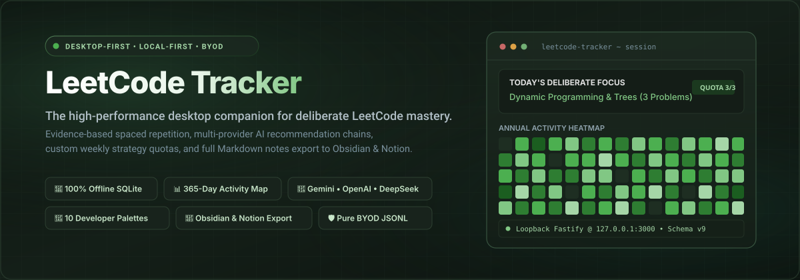
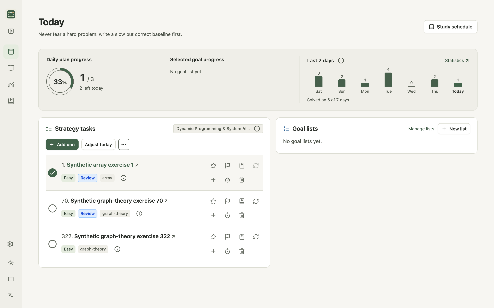
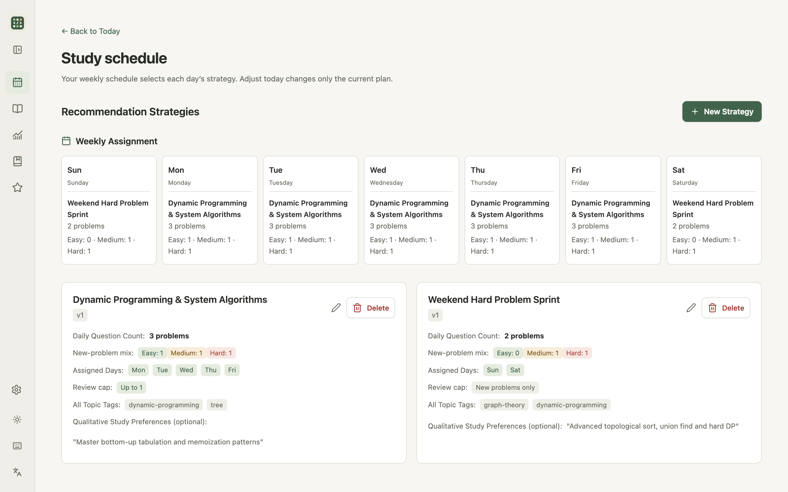
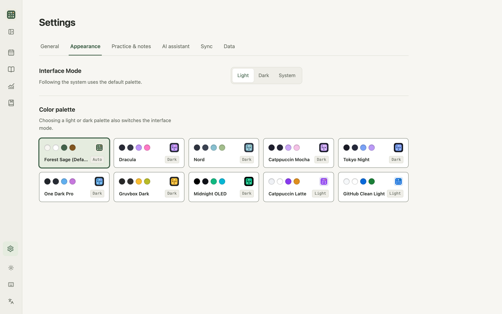
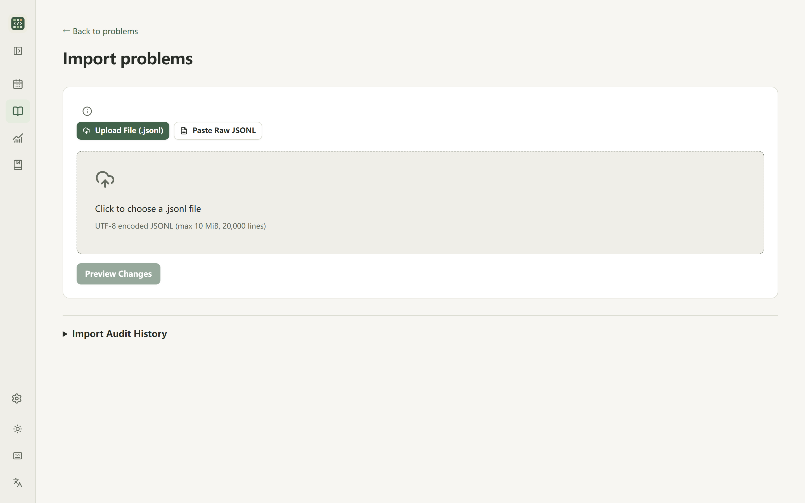

# LeetCode Tracker

<p align="center">
  
</p>

<p align="center">
  <a href="https://github.com/Yide-Milo-Li/LeetCode-Tracker/releases/tag/v1.2.0"></a>
  <a href="docs/desktop.md"></a>
  <a href="tests/README.md"></a>
  <a href="docs/architecture.md"></a>
  <a href="LICENSE"></a>
</p>

A local-first desktop workbench for algorithm practice: bring your own JSONL catalog, plan a weekly routine, record practice, review progress, and keep problem notes together. The interface supports English and Simplified Chinese, desktop windows at 1024px and above, ten theme palettes, and keyboard navigation.

Release 1.2.0 (plus `994f516` UI refinements on `main`) packages the React interface, Fastify API, SQLite engine, and a private Node.js 26 runtime into native Tauri desktop apps for **Windows x64** and **Apple Silicon macOS 14+** (`aarch64-apple-darwin` internal `.app`/`.dmg` build) with the same local-first data model. **End users do not need to install Node.js, npm, Git, or Rust.**

## Download and start

### Windows (x64)

1. Open [Release 1.2.0](https://github.com/Yide-Milo-Li/LeetCode-Tracker/releases/tag/v1.2.0) and download **LeetCode-Tracker_1.2.0_x64-setup.exe** (with `SHA256SUMS.txt`).
2. Run the per-user Windows x64 installer, then launch **LeetCode Tracker** from the Start Menu.

### macOS (Apple Silicon, macOS 14+)

- **Packaged app (internal `.dmg` / `.app`)**:
  1. Open `LeetCode Tracker_1.2.0_aarch64.dmg` (built via `npm run desktop:build:mac` or the `desktop-macos` CI workflow artifact) and drag **LeetCode Tracker.app** into **Applications**.
  2. Because the macOS bundle is **ad-hoc signed and unnotarized**, if macOS shows a Gatekeeper warning on first launch, open **System Settings → Privacy & Security** and click **Open Anyway** (or right-click **LeetCode Tracker.app → Open**).
  3. Closing the red window button hides the window while keeping the app running in the Dock; click the Dock icon to reopen, or press `Cmd+Q` to quit and stop the local backend cleanly.
- **Source-mode one-command launch** (if running from a checkout with Node.js): run `npm run desktop:mac` (or `./scripts/start-desktop.sh` / `npm run desktop`), which checks port `3000`, builds missing web assets, starts the Fastify server, and opens your default browser.

### First-run setup (Windows & macOS)

1. Follow the three-step setup guide that opens on **Today**: confirm your timezone, import your JSON Lines catalog, and pick a study rhythm (a weekday preset, or your own schedule). Any step can be skipped and finished later from **Settings**, **Problems → Import problems**, or **Today → Study schedule**.
2. Optionally configure an AI provider under **Settings → AI assistant**, or import a **Snapshot Bundle v3** under **Settings → Data → Import migration file** when moving a profile between Windows and macOS. Catalog browsing, manual practice, notes, statistics, and local planning remain available without an API key.

The Windows installer is **unsigned** and requires Microsoft WebView2 (the installer downloads its bootstrapper if missing, which requires internet access). Windows 11 x64 is the primary Windows target; clean-machine installation, Windows 10 compatibility, Apple notarization, and non-developer Mac Gatekeeper UX have not completed the full acceptance matrix. See [installation, data paths, and troubleshooting](docs/desktop.md) and [1.2.0 release notes](docs/releases/1.2.0.md).

### Bring your own catalog

No proprietary problem dataset or crawler is shipped. Supply metadata you have permission to use, one JSON object per line:

```jsonl
{"id":"1","title":"Two Sum","difficulty":"Easy","tags":["Array","Hash Table"]}
{"id":"15","title":"3Sum","difficulty":"Medium","tags":["Array","Two Pointers"]}
```

These are format examples, not a bundled curriculum. An AI-generated catalog can contain incorrect IDs, titles, tags, or links; review it before importing. See the [JSONL specification](docs/data-format.md) for accepted fields and normalization rules.

## Practice, understand, and retain

### Today's practice



The unified Today panel combines plan completion, Add one / Adjust today actions, a built-in practice timer linked to practice records, clickable problem titles, dual-path Note navigation (go to workspace or quick-view slide drawer), and seven-day activity. Define reusable weekly strategies with exact difficulty quotas, fixed new/review counts, and topic preferences. Add one runs locally without model calls; remove completed items with explicit confirmation and inspect plan versions. Recommendations explain their source. Local code owns candidate membership, uniqueness, quotas, and persistence; optional Gemini, OpenAI, or DeepSeek assistance remains advisory. Routine explanations and encouragement are local; optional semantic selection is bounded and used only for an effective choice. Opt-in outcome review, duration-shadow calibration, time budgets and explicit optional feedback preserve hard quotas. See [local recommendations](docs/local-recommendations.md) for development-candidate policies and validation limits.

### Progress and topic insights


Progress opens Statistics first, with Records one tab away. Record completion, duration, outcome feedback, and notes; correct or revoke individual records without replacing unrelated history. Explore the yearly activity heatmap, recent trends, and topic insights. Imported progress snapshots are distinguished from individual practice records, and unknown history stays unknown.

### Notes and knowledge export


Browse a filterable problem list alongside a Markdown editor and lightweight preview. Switch between Edit, Split, and Preview, use formatting tools, unclipped quick-copy metadata dropdowns, or enter a focused Notes view. A save/discard/cancel prompt protects unsaved edits when switching problems. Keep solution notes beside each problem and its practice timeline. Export Markdown, an Obsidian ZIP, Notion CSV tables, or a portable snapshot bundle. The desktop app uses a native save dialog and atomically completes the selected file. Bundle exports omit provider keys, and bundle imports ignore incoming keys while preserving local credentials.

### Appearance and keyboard access

Ten palettes, a high-contrast option, English/Chinese text, and light/dark/system appearance support desktop work. All eight gallery screenshots were refreshed for 1.1.0 using an isolated fictional catalog and synthetic practice history. They illustrate the current browser UI, not the full native WebView2 acceptance matrix.

| Shortcut | Action |
| --- | --- |
| `1` / `2` / `3` / `4` | Today / Problems / Progress / Notes |
| `/` | Focus catalog search |
| `n` | Open manual practice entry |
| `?` | Show keyboard help |
| `Esc` | Dismiss the active overlay |
| `⌘S` / `Ctrl+S` | Save active note in Notes workspace |
| `⌘\` / `Ctrl+\` | Toggle Notes focus mode |

See the [workflow guide](docs/desktop-workflow.md) for input guards and context-specific actions. Mobile UI is outside the supported scope.

### Catalog, scheduling, and settings

<details>
<summary>View the remaining desktop screens</summary>







</details>

## Data and optional AI

- The installed desktop profile stores SQLite and backups under `%LOCALAPPDATA%\com.leetcodetracker.desktop\` on Windows or `~/Library/Application Support/com.leetcodetracker.desktop/` on macOS. It does not automatically adopt a source checkout's `.local` database.
- API keys are stored in local SQLite settings without operating-system credential encryption. Raw database backups can contain keys; keep them private.
- AI features send task-relevant inputs to the selected provider or configured gateway. These can include candidate problem metadata, strategy/override text, or pasted progress text. AI-assisted progress import requires a working provider and has no deterministic formatting fallback.
- Supported models and per-model reasoning effort controls in Settings: **Google Gemini** (`models/gemini-3.8-flash`, `models/gemini-4-hydrogen` via `thinkingConfig.thinkingLevel`), **OpenAI** (`gpt-6-luna`, `gpt-6.1-terra` via `reasoning_effort`), and **DeepSeek** (`deepseek-flash` via `reasoning_effort` and `thinking`).
- Portable Snapshot Bundle v5 (schema v12, Phase 39 development candidate) is the complete one-time Windows ↔ macOS migration path for the catalog, saved practice progress, history, notes, plans, review state, and non-sensitive settings. It excludes provider keys, preserves keys already configured on the target, validates references before writing, and replaces the target business profile only after confirmation. Legacy v1 bundles remain partial restore files; v2/v3 imports remain supported. v2 maps missing outcomes to unknown. Incompatible legacy exports fail explicitly rather than dropping new policy/feedback. Published 1.2.0 used schema v10 / Bundle v3.

Read [AI provider behavior](docs/llm-providers.md) and the [security policy](SECURITY.md) before configuring a provider or sharing exports.

## Run from source

Source mode requires **Node.js >=26.13.0 <27** and npm. It uses a desktop browser and is separate from the packaged desktop apps:

```sh
git clone https://github.com/Yide-Milo-Li/LeetCode-Tracker.git
cd LeetCode-Tracker
npm ci
npm run build
npm start
```

Open [the local workbench](http://127.0.0.1:3000), or use the source-mode launcher (`npm run desktop` on Windows/macOS, `start.bat` on Windows, or `npm run desktop:mac` / `./scripts/start-desktop.sh` on macOS) to check ports, build if needed, start Fastify, and open your browser automatically. Source mode supports optional `.env` configuration; the packaged host supplies its own database path, port, and private session credentials. Configure installed-app providers in Settings.

For a native Windows build, install the Rust/MSVC toolchain and run `npm run desktop:build`. On Apple Silicon macOS 14+, install Xcode Command Line Tools and the Rust toolchain (`aarch64-apple-darwin`) and run `npm run desktop:build:mac` to produce `LeetCode Tracker.app` and `LeetCode Tracker_1.2.0_aarch64.dmg`. See the [desktop guide](docs/desktop.md) for prerequisites, outputs, migration steps, and checks. Public GitHub releases currently distribute Windows x64; macOS packages remain internal ad-hoc builds until notarization and external-Mac acceptance are complete.

## Architecture and verification


The host validates the startup handshake, owns the sidecar process (with a Windows Job Object on Windows and bounded graceful stdin shutdown plus `Drop` termination on macOS), and waits for graceful shutdown before enforcing its deadline. Browser source mode uses HTTP directly. See [architecture](docs/architecture.md).

The current Apple Silicon macOS verification passed **430 JavaScript/Web/sidecar tests (285 backend + 144 Web DOM + 1 isolated sidecar), 7 Rust tests, and 2/2 WKWebView E2E specs**, TypeScript checking, documentation links, Rust formatting/clippy, headless Chrome `verify:phase24`, and `.app`/`.dmg` packaging (prior Windows `1.2.0` checks verified NSIS packaging). These are automated/local results; they do not establish clean-VM installation, notarized Gatekeeper UX, live-provider availability, or performance guarantees. [Status](docs/status.md) separates current evidence from historical phase results; [CI](https://github.com/Yide-Milo-Li/LeetCode-Tracker/actions) reports remote runs independently.

## Documentation

- [Documentation index](docs/README.md) · [Desktop installation](docs/desktop.md) · [Release 1.2.0 notes](docs/releases/1.2.0.md)
- [Data format](docs/data-format.md) · [AI providers](docs/llm-providers.md) · [Topic insights](docs/topic-practice-insights.md)
- [Architecture](docs/architecture.md) · [Applications](apps/README.md) · [Shared packages](packages/README.md)
- [Tests](tests/README.md) · [Scripts](scripts/README.md) · [Roadmap](docs/roadmap.md)
- [Contributing](CONTRIBUTING.md) · [Security](SECURITY.md) · [Changelog](CHANGELOG.md)

## License

Code is available under the [MIT License](LICENSE). Users remain responsible for rights to supplied data.
